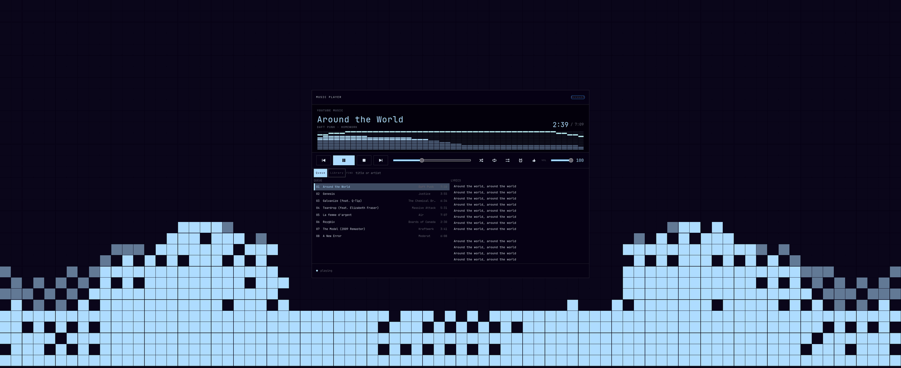
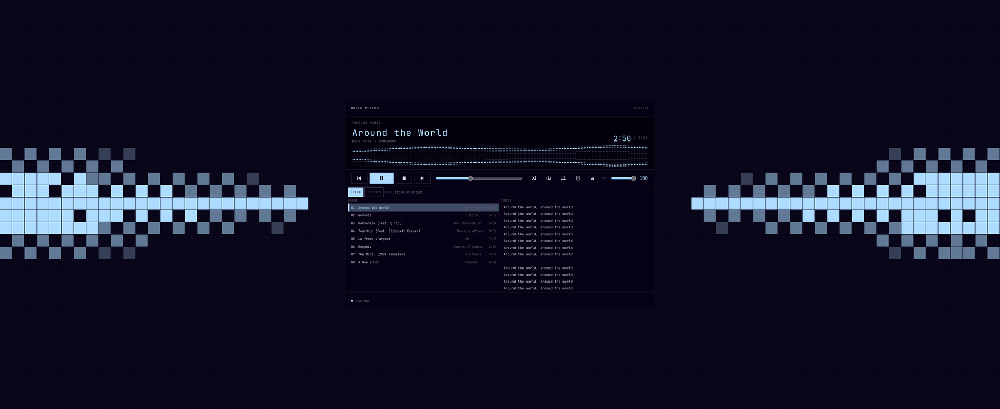
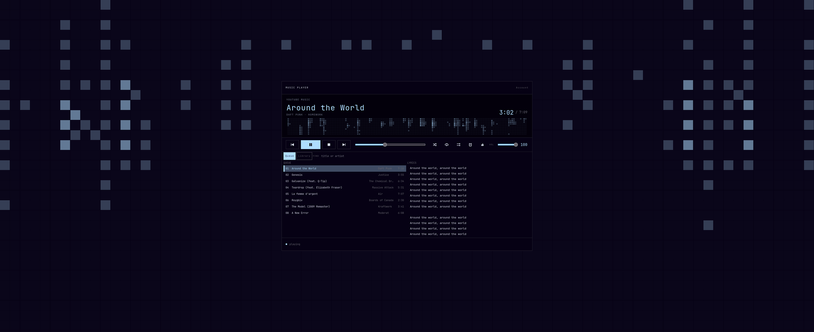
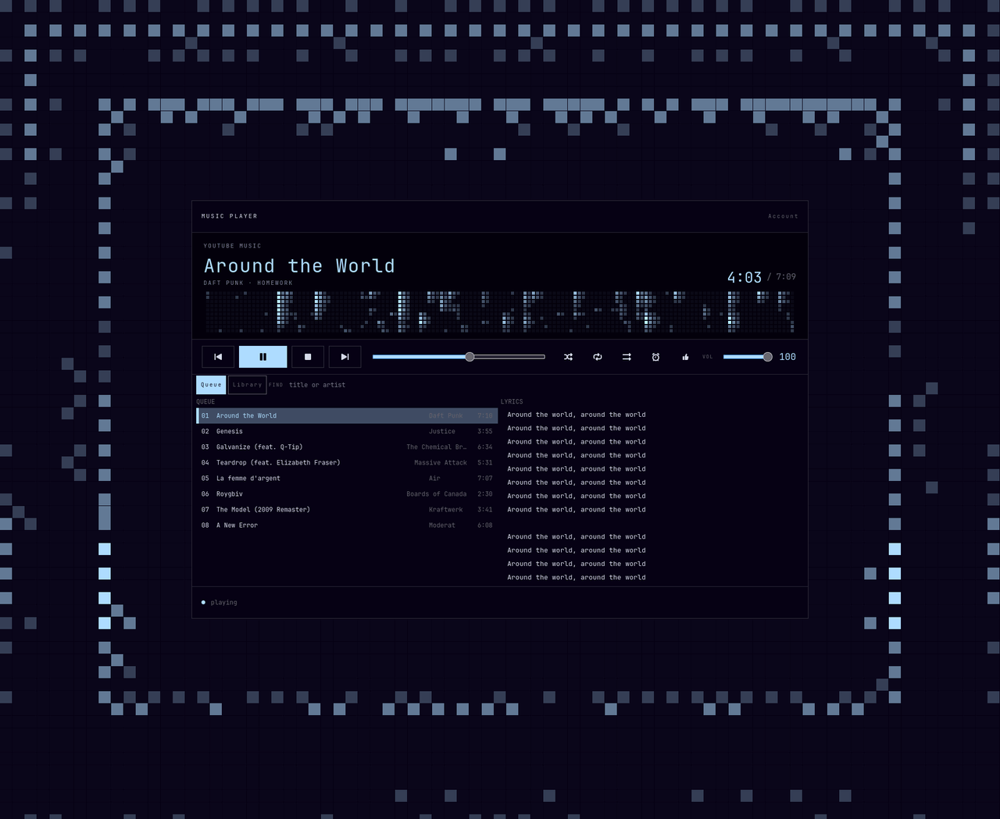

# Music

A standalone YouTube Music player for Arch, CachyOS and Omarchy. GTK4 front end, a small Node engine that talks to YouTube Music's Innertube API through [youtubei.js](https://github.com/LuanRT/YouTube.js), and mpv for playback.

Version 0.2.0. Unofficial, and not affiliated with Google or YouTube. It uses the YouTube Music session of a browser already signed in on this computer.




<details>
<summary>More screenshots: wave, waterfall, half-screen</summary>







</details>

## Features

- **Your library.** Search songs, browse your playlists, and like the current track (it shows up in Liked Music). Premium audio quality is used when the browser session has Premium.
- **Queue.** Drag to reorder, Delete to remove a row, and save one track or the whole queue to a new or existing playlist. Right-click a track to play it next, add it to the queue or start a mix. Right-click a playlist to start a mix, rename it or delete it.
- **Playback.** Gapless: the next stream is already queued in mpv when a track ends. Shuffle, repeat (all or one), play similar when the queue runs out, and a sleep timer.
- **Visualizer.** Three looks: bricks, wave and waterfall. Click the visualizer to cycle through them. It fills the LCD strip and the area around the deck, is capped at 60 fps, and its intensity follows the player volume.
- **Omarchy theme.** Colours come from the current Omarchy theme and repaint live when you switch themes. Accent and peak colours can be overridden in the config.
- **Fits any tile.** The deck keeps its full size on a large screen and shrinks to fit a half-screen or short tile.
- **Desktop integration.** MPRIS, so media keys and other players' controls work. An optional Omarchy bar widget shows the current track and opens the window.
- **Light on resources.** The engine pushes status changes to the window instead of being polled, so an idle player costs almost no CPU.
- **Scriptable.** A local socket, an optional loopback HTTP endpoint and an MCP server expose the same commands. See [docs/agents.md](docs/agents.md).

The window is a client: closing it leaves the engine and the music running. **Ctrl+Q** quits the engine and mpv.

## Requirements

- Node.js 22 or newer, and npm
- mpv
- GTK4 and PyGObject (`gtk4`, `python-gobject`), run with the system `/usr/bin/python3`
- `sqlite` for Firefox, Zen and LibreWolf cookies; `yt-dlp` for Chrome, Chromium, Brave, Edge, Vivaldi and Helium
- A browser on this computer signed in to [YouTube Music](https://music.youtube.com)

## Install

### Arch package

Build the PKGBUILD from a checkout:

```bash
git clone https://github.com/stinsvarning/music-player.git
cd music-player/packaging/aur
makepkg -si
```

The package installs to `/usr`. The Omarchy bar widget and Hyprland snippet are placed in `/usr/share/music-player/` for you to copy if you want them.

### User-local install

```bash
git clone https://github.com/stinsvarning/music-player.git
cd music-player
sudo pacman -S --needed python-gobject gtk4 mpv nodejs npm sqlite yt-dlp
./packaging/install.sh --prefix ~/.local
```

This installs `music-player` to `~/.local/bin` and a desktop entry called **Music**. Make sure `~/.local/bin` is on your `PATH`.

On Omarchy the script also installs two extras, unless you pass `--no-extras`:

- the **Music** bar widget, to `~/.config/omarchy/plugins/llurd.music/` (enable it in the bar if it does not appear)
- a Hyprland window rule, to `~/.config/hypr/music-player.lua` (require it from your `hyprland.lua`)

To open or focus the player with **Super+Shift+M** (Omarchy's default music key), copy the two lines from `packaging/hypr-bindings.lua` into `~/.config/hypr/bindings.lua`.

### Run from a checkout

```bash
cd engine && npm ci && cd ..
./music-player
```

## First run

If no signed-in session is found, the window lists the browsers that have a profile on this computer. Click **Sign in with …** for the one you use; YouTube Music opens in that browser and the player picks up the session. **Check again** re-scans.

**Account → Sign out** forgets the saved session until you sign in again. Your queue is kept.

## Keys

Press **?** in the window for this list.

| Key | Action |
|---|---|
| `Space` | Play / pause |
| `n` / `p` | Next / previous |
| `s` | Stop |
| `←` / `→` | Seek 5 seconds |
| `↑` / `↓` | Volume ±5 |
| `l` | Like or unlike |
| `q` / `m` | Queue / Library view |
| `/` or `Ctrl+F` | Search |
| `Delete` | Remove the selected queue row |
| `Menu` or `Shift+F10` | Context menu |
| `F11` | Fullscreen |
| `Esc` | Leave the search field |
| `Ctrl+Q` | Quit the player and the engine |

## Configuration

Everything is optional. The file is `~/.config/music-player/config.toml`:

```toml
# Which browser session to use. "auto" picks the first signed-in browser it finds.
cookies_from = "auto"
# cookies_from = "firefox:~/.config/zen"

# Visualizer look: bricks, wave or waterfall. Clicking the visualizer updates this,
# and a hand edit is picked up without a restart.
vis_mode = "bricks"

# Override the theme's accent and peak colours.
# accent = "#7aa2f7"
# peak = "#f7768e"
```

## Engine as a systemd user service

By default the window starts the engine when it opens. Run the engine as a user service instead, and it comes up with your graphical session, so media keys and the bar widget work before the window is ever opened:

```bash
./packaging/install-service.sh --enable --now          # the engine installed by install.sh
./packaging/install-service.sh --repo --enable --now   # the engine in this checkout
```

- With the unit installed, opening Music starts the service if needed and attaches to it. If that fails, the window falls back to starting the engine itself.
- **Ctrl+Q** still stops the engine. The service only restarts after a crash, so it stays stopped until your next login or the next time you open Music.
- The unit records the absolute path of `node` (version-manager shims such as mise are resolved). **Rerun the script after upgrading Node.**
- `MUSIC_PLAYER_NO_SYSTEMD=1 music-player` skips the service for one launch.
- Logs: `journalctl --user -u music-player-engine`. Remove it with `./packaging/install-service.sh --remove`.

## How it works

```
GTK4 window (ui/music_player) ──┐
Omarchy bar widget ─────────────┼── Unix socket ──> engine (engine/src, Node) ──> mpv
music-player-ctl / HTTP / MCP ──┘                     │
                                                      ├── YouTube Music (Innertube, youtubei.js)
                                                      └── MPRIS on D-Bus
```

- **Engine** (`engine/src`). Owns the session, queue and playback. It resolves streams through Innertube, drives one long-lived mpv over JSON IPC, keeps the next track queued for gapless playback, and saves the queue and volume between runs. Only one engine runs at a time, listening on `~/.config/music-player/engine.sock`.
- **Visualizer data.** An mpv audio filter splits the signal into ten bands and reports their levels. The window reads them every 80 ms while playing and draws at most 60 frames per second.
- **Window** (`ui/music_player`). A GTK4 client that subscribes to the engine's status stream and only falls back to slow polling when it has to. It watches the Omarchy theme files and `config.toml` and repaints on change.
- **Packaging** (`packaging/`). `install.sh`, `uninstall.sh`, `install-service.sh` with the systemd unit template, the Arch PKGBUILD, the Omarchy bar widget and the Hyprland snippets.

## Development

```bash
(cd engine && npm ci)    # once
cd engine && node --test
cd ui && /usr/bin/python3 -m unittest discover -s tests
```

Run the last two from the repository root.

The UI tests need the system PyGObject, hence `/usr/bin/python3`. Tests that start mpv run it with `--ao=null`, so they never make a sound.

For a silent, headless engine (on its own socket, for example), set `MUSIC_PLAYER_MPV_ARGS="--ao=null"` and `MUSIC_PLAYER_NO_MPRIS=1`.

## Uninstall

Quit the player first with **Ctrl+Q**.

```bash
./packaging/uninstall.sh --prefix ~/.local
```

This removes the launcher, the installed files, the desktop entry and the engine user service. Your session and config stay. Add `--purge-extras` to also remove the bar widget and Hyprland snippet, and `--purge-config` to delete `~/.config/music-player`.

## License

MIT. See [LICENSE](LICENSE).
