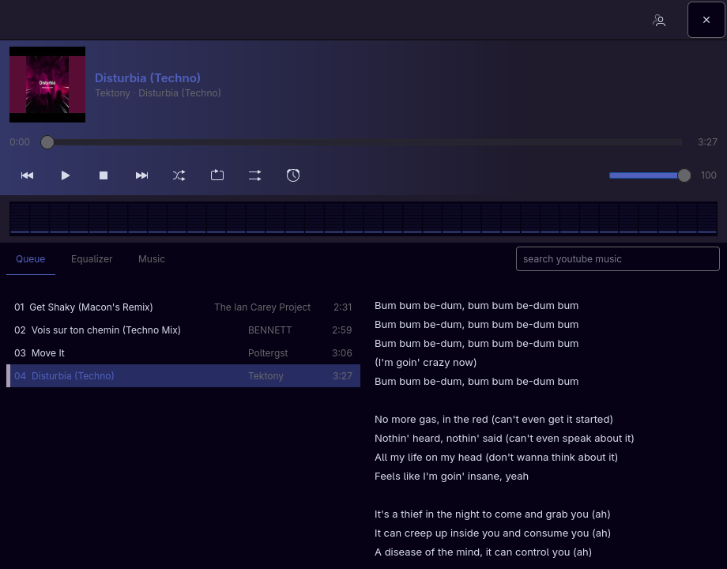
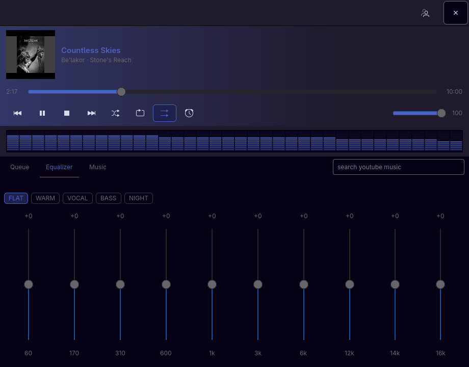
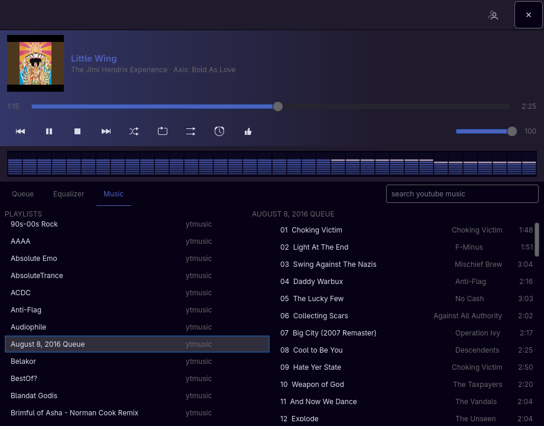

# Music

A compact YouTube Music player for Arch: GTK4 window, Innertube engine, mpv for audio.

**Version 0.1.0.** Unofficial. It uses a YouTube Music session from a browser on this computer. Not affiliated with Google or YouTube.

Works on **Omarchy** and other Arch-family systems including **CachyOS**. The bar widget and Hyprland float rules are optional Omarchy extras.

## Screenshots







## Features

- Plays YouTube Music from the signed-in browser session on this computer
- Queue, lyrics, search, and your playlists
- Like the current track (syncs with Liked Music)
- Right-click a playlist to rename, delete, or start a mix
- Shuffle, repeat, play similar, and a sleep timer
- Full-monitor view: centered deck on a music-reactive dotted field, LCD readout, brick meter
- Close or Super+W hides the window and audio keeps playing; Ctrl+Q quits
- Follows the current Omarchy theme when those files exist
- Optional Omarchy bar chip and Hyprland float rules

## Needs

- Node 22+ (`nodejs`, `npm`)
- mpv
- GTK4 / PyGObject (`python-gobject`, `gtk4`)
- `sqlite` (Firefox / Zen cookies) and `yt-dlp` (Chromium, Chrome, Brave, Edge, Vivaldi)
- A browser on this machine signed into [YouTube Music](https://music.youtube.com)

Premium quality is used when that browser session has it.

## Install (Arch / CachyOS)

From the AUR, once the package is uploaded:

```bash
paru -S music-player-git
# or: yay -S music-player-git
```

Until then, build the same PKGBUILD from this repo:

```bash
git clone https://github.com/stinsvarning/music-player.git
cd music-player/packaging/aur
makepkg -si
```

Or a user-local install without pacman:

```bash
git clone https://github.com/stinsvarning/music-player.git
cd music-player
sudo pacman -S --needed python-gobject gtk4 mpv nodejs npm sqlite yt-dlp
./packaging/install.sh --no-extras --prefix ~/.local
```

The script puts `music-player` on `PATH` (`~/.local/bin`) and a desktop entry named **Music**. Add `~/.local/bin` to `PATH` if your shell does not already. The AUR package installs to `/usr` instead.

## Install (Omarchy)

Same steps, but keep the extras:

```bash
git clone https://github.com/stinsvarning/music-player.git
cd music-player
sudo pacman -S --needed python-gobject gtk4 mpv nodejs npm sqlite yt-dlp
./packaging/install.sh --prefix ~/.local
```

If `~/.config/omarchy` exists, install copies the Music bar widget to `~/.config/omarchy/plugins/llurd.music/`. Enable it in the bar if it is not listed.

If `~/.config/hypr` exists, it writes `~/.config/hypr/music-player.lua` (float 920×720). Require that file from your Hyprland config if the window is not already floated. **Super+Shift+M** can raise or launch the player the same way the bar chip does — copy the two lines from `packaging/hypr-bindings.lua` into `~/.config/hypr/bindings.lua`. That key is Omarchy’s default Music shortcut (normally Spotify).

Missing Omarchy files does not prevent launch. The window follows the current Omarchy theme when present.

## First run

If you are not signed in, the window shows a card. **Sign in** opens YouTube Music in your browser; the app picks up the session when it appears. **Check again** forces a new scan of local browsers.

**Sign out** (person icon) forgets the saved session and stays signed out until you sign in again. The queue on disk is kept.

Optional override:

```toml
# ~/.config/music-player/config.toml
cookies_from = "auto"
# cookies_from = "firefox:~/.config/zen"
```

## Window vs engine

| Action | What happens |
|---|---|
| Close the window / Super+W / Super+X | Hides the window. **Audio keeps playing.** |
| Ctrl+Q | Quits the engine and mpv. |
| Open Music again | Attaches to the running engine if it is still up. |

## Uninstall

Quit the player first (**Ctrl+Q**).

```bash
./packaging/uninstall.sh --prefix ~/.local
```

That removes the binary, library tree, and desktop entry. Session and cookies stay.

```bash
./packaging/uninstall.sh --purge-extras    # also drop the bar plugin and Hyprland snippet
./packaging/uninstall.sh --purge-config    # also delete ~/.config/music-player
```

## License

MIT. See [LICENSE](LICENSE).

Agent, HTTP, and MCP control are documented in [docs/agents.md](docs/agents.md).
